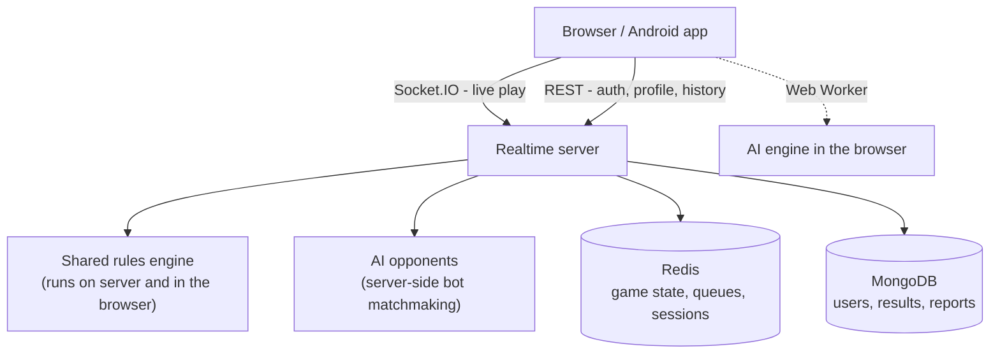

# Quoridor — Online Board Game

A real-time, production-ready online implementation of the classic abstract strategy game
**Quoridor** — built end-to-end: realtime backend, shared rules engine, custom AI, web client,
Android wrapper and deployment. Live at **[playquor.org](https://playquor.org)**.

  

> **Portfolio overview.** The full source code is private. This repository presents the project's
> design, engineering decisions and results — not its implementation.

## What it is

Quoridor is a two-player abstract strategy game on a 9×9 board: each player races a pawn to the far
row while placing walls to slow the opponent down. The app turns that into a full online product:
ranked and casual matchmaking, private rooms, AI opponents, accounts, Elo-style ratings, a
leaderboard, game history and replays, friends, notifications, in-game reactions, a daily puzzle and
a complete admin panel.

## Highlights

- **Server-authoritative realtime gameplay.** A single rules engine is shared between the server and
  the browser. Clients only *suggest* a move; the server validates, persists and broadcasts the
  result, so a tampered client cannot cheat.
- **A real AI engine, not a toy.** A custom engine with versioned iterations, tuned and accepted
  through a measurement harness (matched games, Elo with confidence intervals, SPRT, round-robin
  ratings, perft verification, Texel weight fitting) — no "looks good to me".
- **Product completeness.** Ranked ratings, leaderboard, replays, friends, notifications, daily
  puzzle, product analytics with cohort reporting, moderation tools and an admin panel.
- **Shippable.** Dockerized deployment (app + Mongo + Redis), automatic TLS via Caddy, and an
  Android app via Capacitor.

## Architecture

Client-server with an authoritative server. The rules engine is the single source of truth for game
state, and the same engine runs as the AI opponent.

Key design points:

- **One engine, two places.** The rules engine is written to run unchanged on Node and in the
  browser, so there is no duplicated game logic to drift apart.
- **Redis as the realtime layer** for volatile state (live games, queues, sessions) with an
  in-memory fallback; **MongoDB** for durable data (users, results, reports).
- **Bot opponents** are server-side participants that reuse the same rules and matchmaking flow as
  humans, so a player always finds a game.

## Tech stack

| Layer | Technology |
| --- | --- |
| Backend | Node.js, Express, Socket.IO |
| Realtime state | Redis (with in-memory fallback) |
| Persistence | MongoDB (Mongoose) |
| Auth | Server sessions with secure cookies, hashed credentials |
| Frontend | Vanilla-JS SPA, Canvas board rendering, Chart.js |
| AI | Custom versioned engine (server + Web Worker), tuned on an arena |
| Mobile | Capacitor + Android |
| Infra | Docker Compose, Caddy (TLS), Sentry, rate limiting |

## The AI engine (selected details)

The engine is the part I am most proud of, so it is built like a real one:

- **Versioned search engines**, each validated against the previous version rather than rewritten
  blind.
- **An arena** that plays paired games (same opening, colors swapped) and reports Elo with confidence
  intervals, SPRT with early stopping, and round-robin ratings — so any change is *accepted by
  measurement*.
- **Perft** as a hard contract for the rules (move-generation counts that must not change silently).
- **Loop diagnosis**: repetition draws are treated as a bug and reported separately from strength, so
  tuning cannot optimize a stall.
- **Automatic weight tuning** (Texel-style) and **per-bot personality** so bot accounts have distinct,
  consistent styles.

## Screenshots

  

## Links

- **Play:** [playquor.org](https://playquor.org)
- **Android:** built with Capacitor (see the live site)

## License

This is a personal portfolio project. **All rights reserved.** The source code is private and is not
published here; nothing in this repository may be copied, reused, modified, redistributed or deployed
without the author's prior written permission. See [LICENSE](LICENSE).
